<p align="center">
  
</p>

<p align="center">
  <a href="LICENSE"></a>
  
  
  
</p>

**LetShare** turns a Windows laptop into a Wi-Fi access point for phones, and
owns the parts Windows' Mobile Hotspot keeps getting wrong.

It exists because the built-in hotspot is unreliable in a specific, measurable
way: on some Windows 11 builds, ICS hands out leases with **no DNS option**,
creates no firewall rules, and its resolver binds port 53 without answering.
Clients connect, get an address, and report "connected, no internet".

Rather than fight ICS, LetShare runs a small, supervised stack next to it:

```
        phone
          │  Wi-Fi (WPA2)
          ▼
  ┌───────────────────┐
  │ Wi-Fi Direct AP   │      ← wfd.exe, the legacy AP role, no ICS
  └─────────┬─────────┘
            │  192.168.50.0/24
   ┌────────┴─────────┐
   │ dhcpd            │      ← lease + gateway + DNS (option 6)
   │ dnsrescue        │      ← forwarder with a TTL-aware cache
   └────────┬─────────┘
            ▼
       ┌─────────┐
       │ WinNat  │  ── uplink (Wi-Fi or Ethernet) ──▶ internet
       └─────────┘
            ▲
     letsshare-daemon        ← elevated, windowless, self-healing
```

## Why not just use Mobile Hotspot?

Measured on the reference machine (Windows 11 build 26200, Intel AX203):

- The WinRT tethering API works, but the ICS layer beneath it handed out leases
  containing options `53, 54, 1, 3, 58, 59, 51, 46, 15` — **no option 6**.
- ICS created no firewall rules, and its DNS proxy bound `0.0.0.0:53` while
  answering nothing. Restarting the service did not fix it.
- ICS holds `192.168.137.1:67` exclusively, so the missing option cannot be
  injected from userland.

The details, including the raw DHCP option dump, are in
[PLAN.md](PLAN.md) and [docs/audits/](docs/audits/).

## Requirements

| | |
|---|---|
| OS | Windows 11. Windows 10 2004+ is untested |
| Adapter | Wi-Fi hardware that exposes a Wi-Fi Direct AP role |
| Rights | Administrator for the adapter address and WinNat |
| Build | Rust 1.80+ |

If the laptop has an **Ethernet port**, use it. A wired uplink frees the radio
to serve the phone and roughly doubles throughput.

## Install

```powershell
git clone https://github.com/AffanShaikhsurab/letsshare.git
cd letsshare
cargo build --release -p letsshare-probe

# elevated
.\scripts\install-autostart.ps1
```

The installer:

1. copies the five binaries to `%ProgramFiles%\LetShare` (non-admins cannot
   write there — the elevated task must not run from a checkout);
2. registers `LetShare` at logon with `RunLevel Highest`;
3. registers `LetShare-Watchdog` at logon and every five minutes;
4. starts the supervisor.

Nothing opens a window. Check it:

```powershell
target\release\letsshare-tier2.exe status
```

```
ap=up dhcp=up dns=up address=up nat=up leases=1 dns_queries=42
healthy: true
```

## Join from a phone

The default network is `LetShare-WFD-Test` with the passphrase `letsshare123`.
**That passphrase is published in this repository and is not a secret.** Change
it before you rely on it:

```powershell
setx LETSSHARE_SSID       "MyLaptop"
setx LETSSHARE_PASSPHRASE "a-long-random-passphrase"
# sign out and back in so the logon task inherits them
```

Then join the network. No static DNS, no manual gateway — the lease carries
both.

## Day-to-day

| Task | Command |
|---|---|
| Health | `letsshare-tier2.exe status` |
| Restart one component | `letsshare-tier2.exe restart dhcp\|dns\|ap\|all` |
| Recent activity | `letsshare-tier2.exe logs` |
| Rebuild and redeploy | `.\scripts\clean-restart.ps1` (elevated) |
| Verify the watchdog | `.\scripts\deploy-and-verify.ps1` (elevated) |
| Remove everything | `.\scripts\uninstall-autostart.ps1` (elevated) |

`status` verifies by function, not by process handle: it asks whether a lease
was served, whether the resolver actually answers, and whether the NAT exists.

## How the pieces fit

- **`letsshare-daemon`** supervises `wfd`, `dhcpd` and `dnsrescue`. It restarts
  them with backoff, repairs the adapter address and WinNat every 30 seconds,
  follows the uplink resolver when the laptop changes network, and stands down
  if Windows' Mobile Hotspot is switched on (it would preempt the AP anyway).
- **`letsshare-watchdog`** covers the case Task Scheduler cannot: a task that
  has exhausted its restart budget. It no-ops while a supervisor is alive;
  otherwise it clears orphaned children (killing a parent on Windows does not
  kill its children, and they keep ports 67/53), starts the task and waits for
  the process to appear.
- **`dhcpd`** binds only `192.168.50.1:67`. Binding the wildcard would make it a
  rogue DHCP server on whatever network the laptop is attached to.
- **`dnsrescue`** binds the AP address, uses a fresh socket, its own transaction
  id and a connected upstream socket per query, and caches answers for their
  TTL.
- **WinNat** does the translation in the kernel.

## Performance

Measured on the reference machine with a 2.4 GHz 802.11n uplink at 60% signal:

| | |
|---|---|
| Laptop transmit rate to the router | 14.4 Mbps |
| Measured internet download | 14.41 Mbps |
| Phone path | roughly half, because one radio serves both roles |

The link saturates before any of this software does. Amplifiers and repeaters
cannot raise it: capacity is `B·log2(1+S/N)`, and a store-and-forward relay uses
the medium twice for every frame. See [docs/performance.md](docs/performance.md)
for the measurements and the ranked list of things that actually help (Ethernet
first, a second radio second, 5 GHz third).

## Security and privacy

This is a privileged network tool. Read [SECURITY.md](SECURITY.md) before using
it on a network you do not control. The short version:

- There is **no client isolation**. Clients can reach each other and the laptop.
- The supervisor runs **elevated**; the control channel is unauthenticated and
  can be used by any local process to restart components.
- Logs in `%TEMP%` contain client MACs and every DNS name resolved.
- No firewall rules are created. WinNat is host-global and collides with
  Hyper-V, WSL and Docker.
- The default passphrase is public.

## Limitations

- Single radio: uplink and AP time-share it.
- One AP, no band or channel control (the Windows legacy AP role does not expose
  them).
- No tray UI, no QR join, no release binary yet.
- No IPv6, no client isolation, no firewall management.
- The owned stack is the only path implemented; the "Tier 0" wrapper around
  Windows tethering exists in the codebase but is not wired into the installer.

Some of `PLAN.md` is design intent rather than shipped behaviour; the README is
the source of truth for what runs.

## Development

```powershell
cargo test --workspace
cargo clippy --workspace --all-targets -- -D warnings
```

See [CONTRIBUTING.md](CONTRIBUTING.md). The banner is hand-written:
[docs/banner.svg](docs/banner.svg) for GitHub and
[docs/banner.html](docs/banner.html) for the animated HTML/CSS/JS version.

## Credits

- The `civil_from_days` date algorithm in the watchdog follows Howard Hinnant's
  public description.
- Dependencies are MIT or Apache-2.0; see [NOTICE](NOTICE).

## License

[MIT](LICENSE) © 2026 LetShare contributors.
